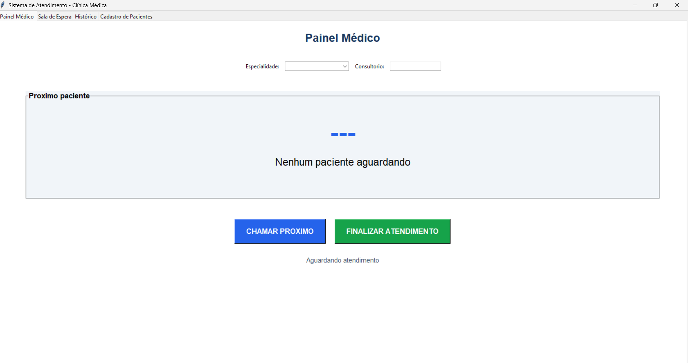
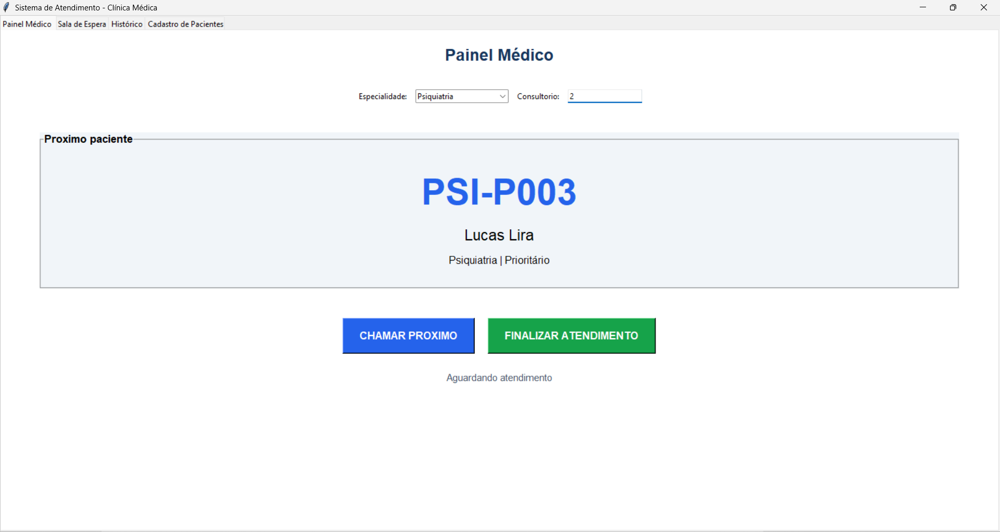
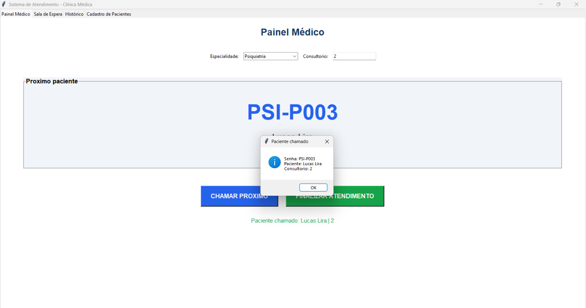
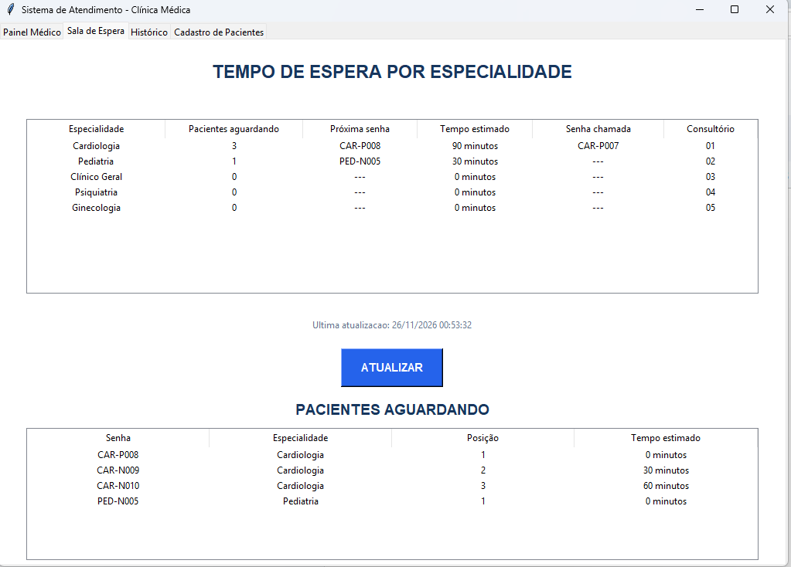
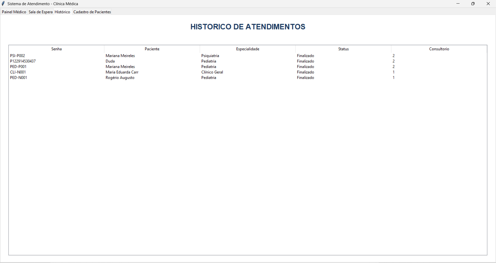
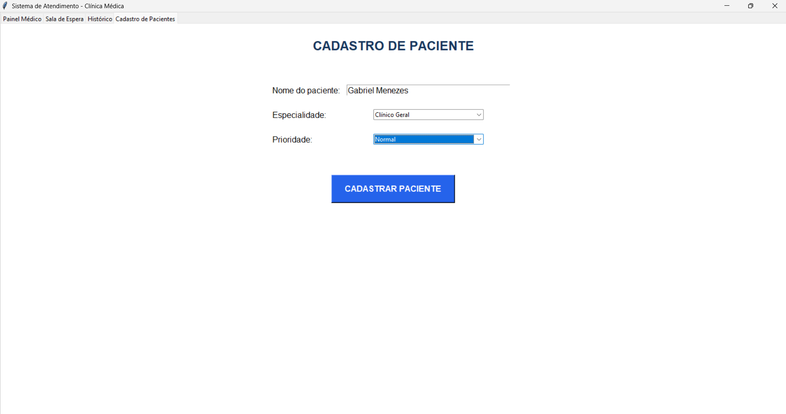

# Sistema de Atendimento - Clínica Médica

Sistema para organizar o atendimento de uma clínica médica: cadastro de
pacientes, filas
por especialidade com prioridade, painel de chamada para o médico, sala
de espera e
histórico de atendimentos.

## Integrantes

| Nome | Matrícula / RGM |
| --- | --- |
| Maria Eduarda Vieira Carr | 43076521 |
| Alex Nauã da Silva Paes | 43555390 |

## Objetivo

Reduzir a desorganização no atendimento de uma clínica, controlando a
ordem de chegada
dos pacientes em cada especialidade, garantindo que casos prioritários
sejam atendidos
primeiro e dando visibilidade do tempo de espera estimado.

## Funcionalidades

- **Cadastro de pacientes:** nome, especialidade e prioridade (Normal ou
Prioritário). O sistema
gera automaticamente uma senha de atendimento (ex.: “CAR-N001”,
“PED-P002”).

- **Painel Médico:** o médico escolhe a especialidade, informa o consultório e
chama o próximo
paciente da fila. Só é possível chamar um novo paciente após finalizar o
atendimento atual.

- **Sala de Espera:** tabela com, por especialidade, a quantidade de pacientes
aguardando, a
próxima senha e o tempo estimado de espera. Também apresenta uma lista
de senhas aguardando, com suas respectivas especialidades, posições na
fila e estimativas individuais de espera.

- **Histórico:** Lista dos atendimentos finalizados, com senha, paciente,
especialidade, status e
consultório.

- **Persistência:** Os dados ficam salvos em um banco SQLite (clinica.db). Ao
reabrir o sistema,
as filas são reconstruídas a partir dos pacientes que ainda estavam
aguardando.

- **Atualização automática:** As telas são atualizadas a cada 10 segundos.

- **Especialidades atendidas:** Cardiologia, Pediatria, Clínico Geral,
Psiquiatria e Ginecologia.

## Estruturas de dados utilizadas

- **Fila (collections.deque):** Cada combinação de especialidade e prioridade
tem sua própria
fila, com inserção no fim e remoção no início (FIFO), ambas em tempo
constante. Cada fila
guarda apenas a senha do paciente.

- **Dicionário aninhado:** Filas (especialidade; prioridade) dá acesso direto
à fila correta (classe
“GerenciadorFilas”, em filas.py).

Listas “Especialidades” e “Prioridades” definem os valores válidos,
usados para validação e
para os campos de seleção da interface.

Dicionário de prefixos “Prefixos” associa cada especialidade ao prefixo
usado na senha

(“CAR”, “PED”, “GIN”, “CLI”, “PSI”).

Banco relacional (SQLite3) a tabela “pacientes” guarda todos os dados do
paciente e o ciclo
de vida do atendimento (Aguardando, Em atendimento, Finalizado), com
datas de cadastro,
chamada e finalização. A coluna “senha” é única.

Biblioteca TKINTER;

As filas em memória definem a ordem de atendimento; o banco guarda os
dados e o
histórico.

## Regras de prioridade

1. Cada especialidade tem filas independentes: um paciente só concorre
com os da mesma
especialidade.

2. Pacientes “Prioritários” são chamados 2 vezes antes dos atendimentos
“Normais”

3. Dentro do mesmo tipo de prioridade, vale a ordem de chegada
(primeiro a chegar,
primeiro a ser atendido).

4. O tempo estimado de espera é calculado como 30 minutos multiplicados
pela quantidade
de pacientes aguardando na especialidade.

5. A senha indica o tipo: “N” para Normal e “P” para Prioritário (ex:
CAR-P001).

## Estrutura do projeto
clinica.py \#Interface gráfica (Tkinter) e arquivo principal
banco.py \#Acesso ao banco SQLite (classe BancoDados)
filas.py \# Filas em memória (classe GerenciadorFilas)
clinica.db \#Banco de dados (criado automaticamente)

## Instalação e execução

## *Requisitos*

1. Na aba *Cadastro de Pacientes*, cadastre alguns pacientes e anote as
senhas geradas.

2. Na aba Painel Médico, selecione a especialidade, o consultório vai
ser preenchido automaticamente. Em seguida, clique em “Chamar Próximo”

3. Ao terminar a consulta, clique em “Finalizar Atendimento”.

4. Acompanhe a fila na aba “Sala de Espera” e os atendimentos
concluídos na aba
“Histórico”.

## Imagens da Interface Gráfica

### Painel Médico

### Sala de Espera

### Histórico

### Cadastro de Pacientes

